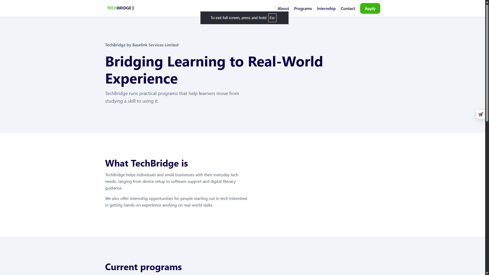
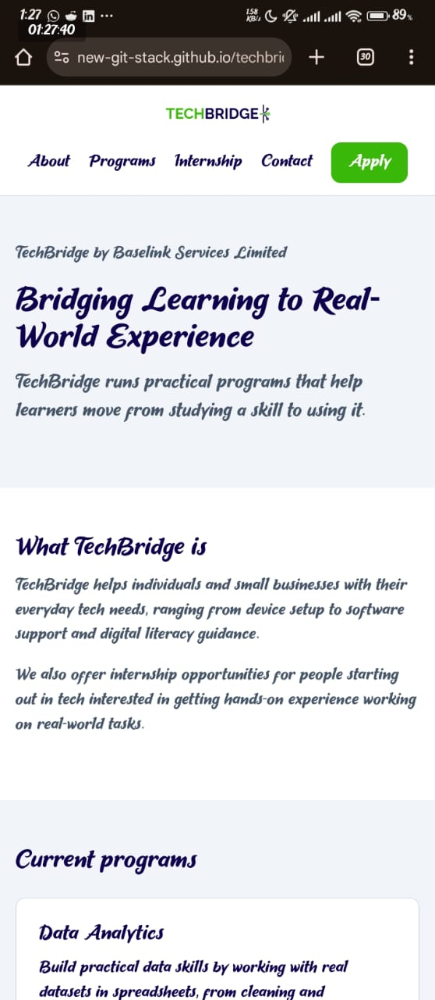

# TechBridge Task 1

Live site: https://new-git-stack.github.io/techbridge-task-1/

## Developer note
My main idea was to match TechBridge’s brand colours as closely as possible, while adjusting the green slightly so the text and buttons stay readable. I built a responsive HTML and CSS website covering what the company does, its internship programs, the benefits for interns, and how to get in touch, and I tested it on my phone as well as my laptop. I learnt how to deploy a website to GitHub Pages, and my main challenge was that changes I pushed weren’t showing up on my phone or laptop because of browser caching. I found that checking the live site in a private tab on my phone and using Ctrl + F5 on my laptop confirms a deploy actually worked.
